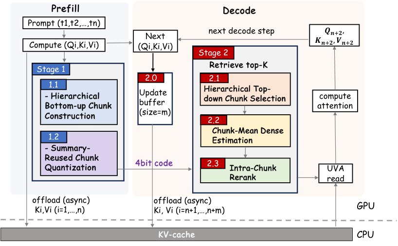

# ZoomKV

**ZoomKV** is a chunk-centric sparse KV-cache retrieval backend for long-context
LLM inference. It combines hierarchical chunk filtering with dense/sparse
chunk-local reranking so decode-time retrieval stays GPU-friendly while keeping
high token-level recall.

<p align="center">
  
</p>

This repository is the cleaned implementation release. The main backend is:

```text
cache_hub/polar_cache_kivi_quest_density_seperate_kernel.py
```

The filename keeps the original experiment spelling (`seperate`) so existing
launch scripts and configs remain compatible.

## Highlights

- **Stage 1: hierarchical Quest chunk filtering.** ZoomKV first selects large
  parent chunks, then scores only their child chunks. This preserves small-chunk
  retrieval resolution while avoiding a global fine-grained Top-K over the full
  context.
- **Stage 2: dense/sparse KIVI reranking.** Candidate chunks are split by a
  chunk-mean query score. Dense chunks keep a larger local budget, sparse chunks
  keep a smaller local budget, and only the survivors enter the final global
  Top-K.
- **CUDA-first critical path.** The release includes the CUDA extensions used by
  the production path: KIVI QK rerank, dense/sparse scoring, fused float Top-K,
  gather, and H2D transfer helpers.
- **Offload-aware KV cache.** The backend keeps the full KV cache available and
  retrieves query-relevant keys on demand.

## Repository Layout

```text
ZoomKV/
├── cache_hub/
│   ├── polar_cache_kivi_quest_density_seperate_kernel.py  # main ZoomKV backend
│   ├── kivi/       # KIVI packed-QK CUDA rerank
│   ├── rerank/     # dense/sparse scoring and rerank kernels
│   ├── topk/       # fused float Top-K kernels
│   ├── gather/     # CPU/GPU gather helpers
│   └── gather_trans/
├── attn_hub/       # attention wrappers
├── model_hub/      # Qwen/Llama model wrappers
├── config/         # model config examples
├── run/            # LongBench-v2 and profiling entry points
├── run_ruler/      # RULER entry points
├── tests/          # lightweight kernel tests
└── assets/         # README figures
```

## Installation

The code is intended for NVIDIA GPUs with CUDA and PyTorch extension support.
We tested on A800/H20-class GPUs. For 128K contexts, use GPUs with at least
80GB memory; H20-class larger-memory GPUs are useful for speed scaling.

```bash
conda create -n zoomkv python=3.10 -y
conda activate zoomkv

# Install a CUDA-enabled PyTorch build matching your driver.
# Example for CUDA 12.8 wheels:
pip install torch torchvision torchaudio --index-url https://download.pytorch.org/whl/cu128

pip install -r requirements.txt
```

If you switch Python or CUDA environments, remove stale JIT products before the
next run:

```bash
find cache_hub -path "*/build/*" -name "*.so" -delete
```

## Quick Start

Download a model and place it under `models/`, or pass an absolute path through
`MODEL_NAME`.

```bash
huggingface-cli download Qwen/Qwen3-4B-Thinking-2507 \
  --local-dir models/Qwen3-4B-Thinking-2507
```

Run a small LongBench-v2 smoke test:

```bash
MODEL_NAME=models/Qwen3-4B-Thinking-2507 \
CUDA_DEVICE=0 \
NUM_SAMPLES=8 \
FINAL_TOPK=100 \
bash run/run_longbench_v2_zoomkv.sh
```

The script sets:

```bash
POLAR_CACHE_MODULE=cache_hub.polar_cache_kivi_quest_density_seperate_kernel
POLAR_QUEST_HIERARCHICAL=1
POLAR_QUEST_CHUNK=16
POLAR_QUEST_LARGE_CHUNK=256
POLAR_QUEST_LARGE_RATIO=0.8
POLAR_QUEST_SMALL_RATIO=0.5
POLAR_CDS_DENSE_RATIO=0.4
POLAR_CDS_DENSE_TOPK=16
POLAR_CDS_SPARSE_TOPK=8
```

LongBench-v2 uses two-stage CoT decoding in our setup: up to 1024 reasoning
tokens, followed by a 512-token answer phase.

## Main Backend

The production backend is selected with:

```bash
export POLAR_CACHE_MODULE=cache_hub.polar_cache_kivi_quest_density_seperate_kernel
```

The backend keeps the same `polar_cache` class interface as earlier PolarANN
variants, so existing `model_hub/qwen.py` and `model_hub/llama.py` can load it
through the `PolarANN.cache_module` config field or the environment variable
above.

Key runtime knobs:

| Variable | Default in quick start | Meaning |
|---|---:|---|
| `POLAR_QUEST_CHUNK` | `16` | child chunk size |
| `POLAR_QUEST_LARGE_CHUNK` | `256` | parent chunk size |
| `POLAR_QUEST_LARGE_RATIO` | `0.8` | retained parent chunk ratio |
| `POLAR_QUEST_SMALL_RATIO` | `0.5` | retained child ratio inside selected parents |
| `POLAR_CDS_DENSE_RATIO` | `0.4` | fraction of candidate chunks treated as dense |
| `POLAR_CDS_DENSE_TOPK` | `16` | local token budget for dense chunks |
| `POLAR_CDS_SPARSE_TOPK` | `8` | local token budget for sparse chunks |
| `FINAL_TOPK` | `100` | final retrieved token budget |

## Results Snapshot

The following numbers are from our paper configuration. They are included to
make the expected behavior easy to sanity-check.

### Token-Level Recall Screening

Qwen3-4B, 128K context, fixed retrieval budgets:

| Method | Recall@100 | Recall@500 | Recall@1000 |
|---|---:|---:|---:|
| Quest | 13.3 | 14.7 | 16.8 |
| Twilight | 70.9 | 62.2 | 60.1 |
| ParisKV | 46.6 | 39.3 | 37.8 |
| **ZoomKV** | **85.8** | **81.0** | **77.1** |

### LongBench-v2 Accuracy

Under CoT decoding with final retrieval budget 100:

| Model | Full Attention | ParisKV | ZoomKV |
|---|---:|---:|---:|
| Qwen3-4B | 25.84 | 24.60 | **30.22** |
| Qwen3-8B | 33.59 | 33.07 | **34.36** |
| DS-R1-Llama-8B | 13.12 | 28.43 | **28.86** |

### RULER Accuracy

Llama-3.1-8B, 128K context, top-k=2048:

| Method | Avg. |
|---|---:|
| Quest | 79.34 |
| ParisKV | 83.49 |
| Full Attention | 84.12 |
| **ZoomKV** | **83.50** |

### Efficiency Summary

On Qwen3-4B at 128K context, ZoomKV reaches 85.8% Recall@100 while
substantially reducing decode TPOT versus high-recall baselines. Under context
scaling, TPOT stays nearly flat from 64K to 1024K in our measured setup.

## RULER

Example RULER launch scripts are under `run_ruler/`. The KIVI ZoomKV scripts
already set the main backend:

```bash
bash run_ruler/run_ruler_qwen3_8b_kivi_quest_density.sh
```

Adjust model paths, task lists, and GPU ids inside the scripts for your machine.

## Profiling

Nsight Systems profiling entry point:

```bash
CUDA_DEVICE=0 BATCH_SIZE=8 FINAL_TOPK=100 bash run/run_nsys_throughput_cds.sh
```

This produces `.nsys-rep` files under `results/`, which are ignored by git.

## Notes

- Model weights and datasets are not included.
- The CUDA extensions are compiled lazily by `torch.utils.cpp_extension.load`.
- The implementation assumes the KIVI speed path uses 4-bit packing and
  `head_dim=128`.
- If your GitHub checkout path changes, no absolute codebook path is required
  for the KIVI backend; configs set `codebook_path` to an empty string.

## Citation

Paper citation will be added after the manuscript is public.
